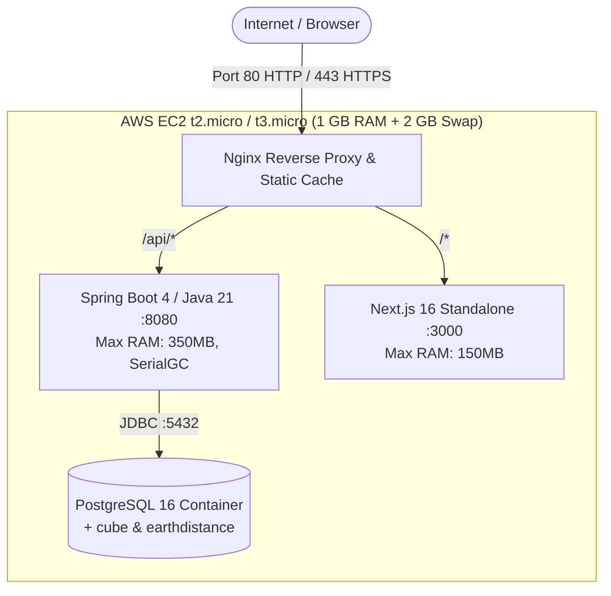

# Complete Step-by-Step Guide: Deploying Suwa Sarana on AWS Free Tier

This guide is designed for **complete beginners** with **zero prior cloud deployment experience**. It walks you through every single step—from creating your AWS account to having your full application live on the web with a public URL.

---

## 1. AWS Free Tier Overview: How to Stay 100% Free

Amazon Web Services (AWS) provides a generous Free Tier for 12 months for new accounts:

| Resource | AWS Free Tier Allowance | How Suwa Sarana Uses It |
| :--- | :--- | :--- |
| **Amazon EC2** (Virtual Server) | **750 hours/month** of `t2.micro` or `t3.micro` | Runs our Nginx Web Server, Next.js Frontend, Spring Boot Backend, and PostgreSQL database. *(750 hours = 24/7 all month!)* |
| **Amazon EBS** (Disk Storage) | **30 GB** General Purpose SSD (`gp3` or `gp2`) | Operating system, project files, and database storage (we allocate 25 GB). |
| **Data Transfer** | **100 GB/month** internet outbound | Browser requests, API data, images. |

> [!IMPORTANT]
> **To ensure your deployment stays $0.00:**
> 1. Always select **Ubuntu 24.04 LTS** (or 22.04 LTS).
> 2. Always select instance type **`t2.micro`** (or **`t3.micro`** in regions where t2 is unavailable).
> 3. Keep storage at **25 GB** or **30 GB** (never exceed 30 GB).
> 4. Run only **one** EC2 instance at a time.

---

## 2. Architecture on AWS Free Tier

To fit comfortably inside the 1 GB RAM of an EC2 micro instance, we use an optimized multi-tier architecture:



---

## 3. Step 1: Launch Your EC2 Virtual Server

### 3.1 Sign in to AWS Console
1. Open the [AWS Management Console](https://aws.amazon.com/console/) and sign in.
2. In the top-right corner, select your region (e.g., **Singapore `ap-southeast-1`**, **Mumbai `ap-south-1`**, or **N. Virginia `us-east-1`**). *Tip: Singapore or Mumbai offers the lowest network latency for Sri Lanka!*

### 3.2 Open EC2 and Launch an Instance
1. In the search bar at the top, type **EC2** and click on **EC2**.
2. Click the orange **Launch Instance** button.
3. Configure the following fields:

| Field | What to Select | Notes |
| :--- | :--- | :--- |
| **Name** | `suwa-sarana-server` | Any descriptive name. |
| **Application and OS Image** | **Ubuntu** | Choose **Ubuntu Server 24.04 LTS (HVM), SSD Volume Type** (marked *"Free tier eligible"*). |
| **Architecture** | **64-bit (x86)** | Standard x86 architecture. |
| **Instance Type** | **`t2.micro`** (or **`t3.micro`**) | Must say *"Free tier eligible"*. (1 vCPU, 1 GiB Memory). |

### 3.3 Create a Key Pair (For SSH Access)
1. Under **Key pair (login)**, click **Create new key pair**.
2. Key pair name: `suwa-sarana-key`.
3. Key pair type: **RSA**.
4. Private key file format:
   - Choose **`.pem`** (recommended for OpenSSH, PowerShell, macOS, Linux).
5. Click **Create key pair**. A file named `suwa-sarana-key.pem` will automatically download to your computer. **Keep this file safe! You will need it to log in.**

### 3.4 Configure Network & Security Group (Firewall)
Under **Network settings**, click **Edit**:
1. Check **Allow SSH traffic from**: select **My IP** (or *Anywhere 0.0.0.0/0* if you have a dynamic home IP).
2. Check **Allow HTTP traffic from the internet** (Port 80).
3. Check **Allow HTTPS traffic from the internet** (Port 443).

### 3.5 Configure Storage
1. Change **Size (GiB)** from `8` to **`25`** GiB (Free tier allows up to 30 GiB).
2. Volume type: **`gp3`** (or `gp2`).

### 3.6 Launch
Click **Launch instance** at the bottom-right. Within 1 minute, your server will be running!

---

## 4. Step 2: Connect to Your Server

### Option A: Using AWS Browser Console (Easiest, No Software Needed)
1. Go to **EC2 > Instances** in AWS Console.
2. Select your instance `suwa-sarana-server`.
3. Click the **Connect** button at the top.
4. Select the **EC2 Instance Connect** tab.
5. Click the orange **Connect** button. A black terminal window will open in your browser!

### Option B: Using Windows PowerShell or Mac/Linux Terminal
1. Open PowerShell and navigate to where you downloaded `suwa-sarana-key.pem`:
   ```powershell
   cd ~/Downloads
   ```
2. (Windows) If permissions are needed:
   ```powershell
   icacls.exe .\suwa-sarana-key.pem /reset
   icacls.exe .\suwa-sarana-key.pem /grant:r "$($env:username):(R)"
   icacls.exe .\suwa-sarana-key.pem /inheritance:r
   ```
3. Connect using SSH (replace `YOUR_EC2_PUBLIC_IP` with your instance's Public IPv4 address from AWS Console):
   ```bash
   ssh -i suwa-sarana-key.pem ubuntu@YOUR_EC2_PUBLIC_IP
   ```

---

## 5. Step 3: Run the Automated Setup Script

Once logged in to your server, run the setup script. It performs everything automatically:
- Creates a **2 GB Swap file** (critical so the server never runs out of RAM).
- Installs **Docker** & **Docker Compose**.
- Configures the **UFW Firewall**.

Run these commands:

```bash
# 1. Clone the repository
git clone https://github.com/Dhanushkamg/Suwa-Sarana.git
cd Suwa-Sarana

# 2. Make the setup script executable and run it
chmod +x deploy/aws-setup.sh
./deploy/aws-setup.sh

# 3. Apply the new docker group permissions to your terminal session
newgrp docker
```

---

## 6. Step 4: Configure Environment Variables

The setup script automatically generated a `.env.production` file with cryptographically secure random passwords and a 64-byte JWT secret!

Open `.env.production` to insert your EC2 Public IP:

```bash
nano .env.production
```

Look for these lines and replace `http://localhost` with `http://YOUR_EC2_PUBLIC_IP`:

```properties
PUBLIC_HOST=http://YOUR_EC2_PUBLIC_IP
CORS_ALLOWED_ORIGIN=http://YOUR_EC2_PUBLIC_IP
FRONTEND_URL=http://YOUR_EC2_PUBLIC_IP
PUBLIC_BASE_URL=http://YOUR_EC2_PUBLIC_IP

NEXT_PUBLIC_API_URL=/api
NEXT_PUBLIC_SITE_URL=http://YOUR_EC2_PUBLIC_IP
```

> **Nano Editor Shortcuts**:
> - Edit with arrow keys.
> - Save: Press `Ctrl + O`, then `Enter`.
> - Exit: Press `Ctrl + X`.

---

## 7. Step 5: Build & Launch Suwa Sarana

Start all services in detached production mode:

```bash
docker compose -f docker-compose.prod.yml --env-file .env.production up -d --build
```

Docker will now:
1. Build the lightweight Next.js 16 standalone container.
2. Build the slim Spring Boot 4 JRE container.
3. Start PostgreSQL with automated Flyway database migrations (`V1` to `V21`).
4. Start Nginx on Port 80 to route requests.

### Check Status:
```bash
docker compose -f docker-compose.prod.yml ps
```
You will see 4 containers running healthy:
- `suwasarana-prod-nginx` (Up, Port 80)
- `suwasarana-prod-frontend` (Up, Port 3000)
- `suwasarana-prod-backend` (Up, Port 8080)
- `suwasarana-prod-db` (Up, Port 5432)

---

## 8. Step 6: Verify in Your Browser!

Open your web browser and navigate to:
```
http://YOUR_EC2_PUBLIC_IP
```

- **Frontend Homepage**: `http://YOUR_EC2_PUBLIC_IP`
- **Backend API & Health**: `http://YOUR_EC2_PUBLIC_IP/actuator/health`
- **API Swagger Documentation**: `http://YOUR_EC2_PUBLIC_IP/swagger-ui.html`
- **Live AI Chatbot**: Test donor questions in English, Sinhala, or Tamil!

---

## 9. Step 7: Create Your First Admin Account

For security, public registration cannot register `ADMIN` users. To create your administrator account:

1. Register an account through the UI at `http://YOUR_EC2_PUBLIC_IP` with your email (e.g. `admin@suwasarana.lk`).
2. Promote your account to `ADMIN` in the database:
   ```bash
   docker exec -it suwasarana-prod-db psql -U suwa_admin -d suwa_sarana_prod -c "UPDATE users SET role = 'ADMIN', verification_status = 'VERIFIED' WHERE email = 'admin@suwasarana.lk';"
   ```
3. Log out and log back in on the website. You now have full access to the Administrator Verification & Fraud Triage dashboards!

---

## 10. Step 8 (Optional): Add Free Custom Domain & Free SSL (HTTPS)

If you have a domain (e.g., `suwasarana.lk` or a free subdomain from [DuckDNS.org](https://www.duckdns.org/)):

1. Point your domain's DNS `A Record` to your `EC2_PUBLIC_IP`.
2. Update `.env.production`:
   ```properties
   ALLOW_HTTP=false
   COOKIE_SECURE=true
   CORS_ALLOWED_ORIGIN=https://yourdomain.com
   FRONTEND_URL=https://yourdomain.com
   PUBLIC_BASE_URL=https://yourdomain.com
   NEXT_PUBLIC_SITE_URL=https://yourdomain.com
   ```
3. Run Certbot to generate a free Let's Encrypt SSL certificate:
   ```bash
   sudo apt-get install -y certbot
   sudo certbot certonly --standalone -d yourdomain.com
   ```
4. Restart docker compose:
   ```bash
   docker compose -f docker-compose.prod.yml restart
   ```

---

## 11. AWS Zero-Cost Protection: Set Up a Billing Alarm

To guarantee AWS never charges you by surprise:
1. In AWS Console search for **Budgets** or **Billing**.
2. Click **Create budget**.
3. Choose **Zero spend budget**.
4. Enter your email address.
AWS will immediately email you if your usage approaches any non-free tier service.
